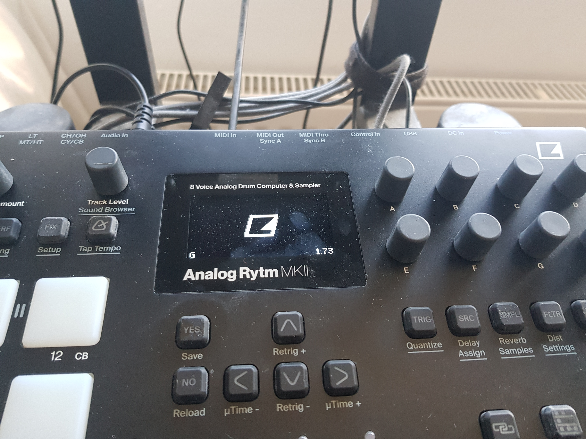
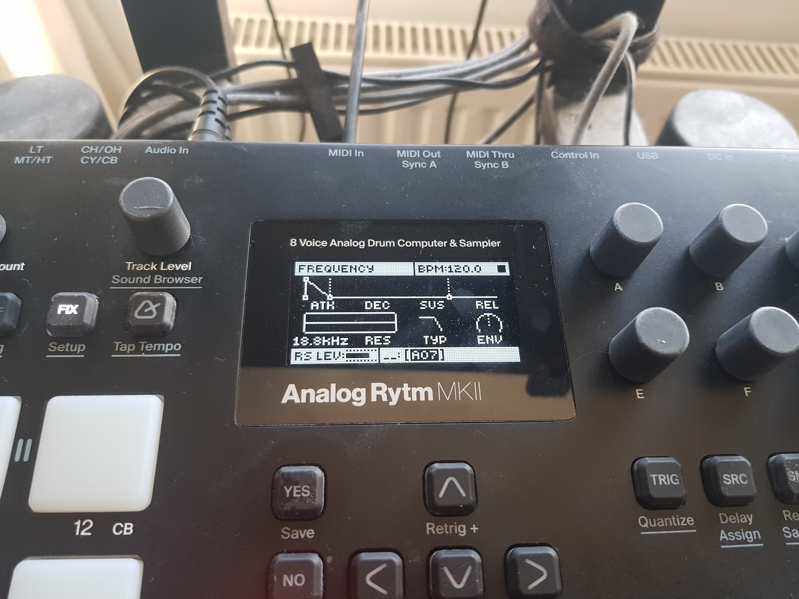
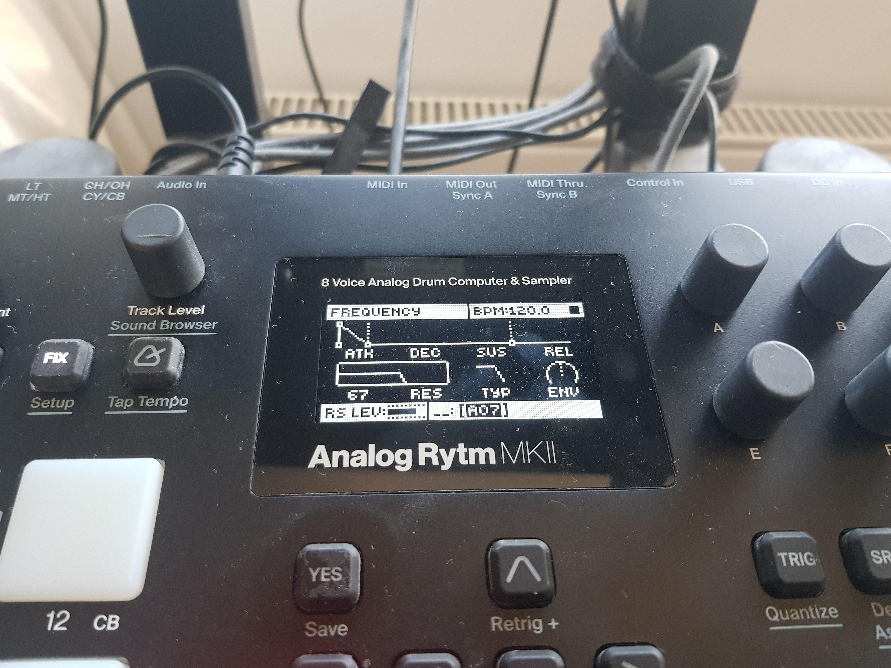

# Boot report: modified OS 1.73 on the Analog Rytm MKII

This report records one build of [rytm-mods-src](https://github.com/ConnorWay32/rytm-mods-src): Elektron's stock OS 1.73 file rebuilt byte for byte, then a modified build flashed to a real Analog Rytm MKII, booted, and recovered with the stock OS. It provides evidence for steps 2, "Stock file rebuilt exactly", and 3, "Modified OS boots", of Modwerk's [Add a machine](https://github.com/repeat98/modwerk/blob/main/docs/ADD_A_MACHINE.md) process, on OS 1.73.

No firmware is included in this repository: not the stock OS, the built `.syx`, any extracted section, or any disassembly. Only hashes, sizes, addresses and observations are recorded.

The mods are MrScruff's work, redistributed with permission in rytm-mods-src.

## 1. What was built

### Source

| | |
|---|---|
| Source repository | https://github.com/ConnorWay32/rytm-mods-src |
| Source commit | `cf5ac0062b2465d080070a39f257cc9c62f4604b` (the repository's initial commit) |
| Build command | `make verify` (default mod set) |
| Built on | 2026-10-10 |
| Build host | Ubuntu 24.04.4 LTS under WSL |

The build tree (`~/rytm-mods-src` under WSL) was a local copy rather than a clone. After the build, it was compared with a fresh clone of that commit using `diff -rq`, excluding `.git`, `.venv`, `build`, `vendor` and `__pycache__` (generated by `make setup` and the build):

- **Every tracked file was identical to the commit**, including `Makefile`, `requirements.txt`, `tools/`, `mods/`, `registry/`, `re/`, `docs/` and `README.md`.
- **`stock/` differed only by `Analog-Rytm_MKII_OS1.73.syx`**, the builder's own copy of Elektron's file. It is not redistributed, and its hash is checked below.

### Toolchain

| Tool | Version |
|---|---|
| GNU binutils (`m68k-elf-as`), built from source for `--target=m68k-elf` | `GNU assembler (GNU Binutils) 2.47.20260726`, as reported by `m68k-elf-as --version` |
| Python | 3.12.3 |
| GCC, used to build elektron-firmware-tool | 13.3.0 (`Ubuntu 13.3.0-6ubuntu2~24.04.1`) |
| elektron-firmware-tool | commit `a5bce9a6af644386d900924082993a805e812874`, pinned by the rytm-mods-src `Makefile` |

### Input

| | |
|---|---|
| Stock file | `Analog-Rytm_MKII_OS1.73.syx` (Elektron, OS 1.73), supplied by the builder and not redistributed |
| Stock SHA-256 | `8ad671087ec30433d5407c7380d2396e0915ab931c5d3dd18a78bf284d3d1e52`, matching `stock/SHA256SUMS` |
| Stock MAIN OS section | 3,005,432 B, SHA-256 `28d9ef40c895e03f17dfce096543109adaf708947392db72818fc2a412d685d6` |
| Stock bootstrap section | 42,302 B, SHA-256 `1b8d3b7288df118512740ac7c59d8dd9f71f44e6633a29628bcb068d756e2ed8`, matching the hash pinned in the source's `docs/HAZARDS.md` |

### Stock rebuild

Before applying any mods, the build unpacks the stock `.syx` and repacks it unchanged with elektron-firmware-tool (the "null repack"), writing `build/null_repack.syx`.

| | |
|---|---|
| Null repack file | `build/null_repack.syx`, 1,880,224 B |
| Null repack SHA-256 | `8ad671087ec30433d5407c7380d2396e0915ab931c5d3dd18a78bf284d3d1e52` |
| Stock SHA-256 | `8ad671087ec30433d5407c7380d2396e0915ab931c5d3dd18a78bf284d3d1e52` |

The hashes match: the tool rebuilt Elektron's OS 1.73 file byte for byte. The null repack uses the tool's `-r` mode, which decodes the SysEx transport, parses the container, reassembles it and re-encodes the transport, copying each compressed section verbatim. It therefore shows the transport and container layers round-trip losslessly; it does not recompress any section. Recompression is covered separately by the build verification below: the modified MAIN OS is compressed into the built `.syx` and comes back out byte-identical. Anyone with the stock file can check the hash against their own download.

### Output

| | |
|---|---|
| File | `Analog-Rytm_MKII_OS1.73_0000_0002_0003_0004_0006_0008_0009_0010_0012_0013_0014_0015.syx` |
| Size | 1,799,712 B |
| SHA-256 | `877831d761eb796c54ba948d60af4a955211afb7234da78c7ed6d2611298a82f` |
| MAIN OS section | 3,005,432 B (same size as stock), SHA-256 `5220313c7379879ba0fe4d1f3b2764e153ee11dcc52f172d927a3c57acf7224a` |

### Mods in this build

All twelve mods in the default build were included. The status column is the source repository's own label at this commit. Only `hardware-verified` counts there, and this report does not change those labels.

| Mod | What it does | Status in source |
|---|---|---|
| 0000-shared | Shared runtime the other mods call into | built |
| 0002-euclid-accents | Euclidean generator places accents instead of trigs | hardware-verified |
| 0003-velocity-humanise | Per-track random velocity offset | built |
| 0004-lfo-rnd | Two per-sound random modifiers on a second LFO page | built |
| 0006-comp-preview | Scrolling compressor gain-reduction estimate | hardware-verified |
| 0008-filter-hz | Filter frequency shown in Hz | hardware-verified |
| 0009-main-rms | Main output RMS indicator on the compressor VOL label | built |
| 0010-kit-ab | NO + PLAY toggles between the edited kit and the saved one | hardware-verified |
| 0012-slice-loop | SLICE LOOP in the track menu | hardware-verified |
| 0013-voice-dac | Voices to MAIN through the DAC, with a per-sound filter | hardware-verified |
| 0014-ctrl-all | TRK + knob turns that parameter on every sound track | hardware-verified |
| 0015-env-reset-amp | ENV RESET reaches AMP and AMP+FILT | hardware-verified |

### Build verification

`make verify` ended in `PASS`. The log is in [`verify_output_redacted.txt`](verify_output_redacted.txt). It is the complete output with one change: wherever the log printed stock Elektron bytes, they are replaced with `<stock>`. That covers 60 `displaced` lines (the stock instructions each detour replaced) and 68 build `patch` lines (the value before each patch). Every address, claim name, new value, `ok` result and the final `PASS` are unchanged. It confirms that:

- **The container tool is faithful.** The untouched stock `.syx` rebuilds byte for byte (null repack; hashes above).
- **The recovery path is intact.** The bootstrap section is unchanged (42,302 B), so the STARTUP menu's DIN-MIDI OS UPGRADE still works.
- **Only MAIN OS changed.** The FPGA (149,516 B), meta (15 B) and section 8 (159,948 B) sections are unchanged, and MAIN OS keeps its stock size and round-trips byte-identically out of the built `.syx`.
- **Every change was intended.** All 101 regions that differ from stock lie inside claims in the source's `registry/allocations.toml`.
- **The patches are consistent.** Every patch holds its intended value, and every detour jumps to its linked stub symbol.
- **Displaced instructions are preserved.** The stock instructions each detour displaced are either re-emitted in that mod's stub or explicitly reimplemented there, as declared.

## 2. Flashing and boot

| | |
|---|---|
| Date | 2026-10-11 |
| Unit | Elektron Analog Rytm MKII, previously running stock OS 1.73 |
| Route | Elektron Transfer 1.10.3 over USB, the normal OS update route in the source's `docs/FLASHING.md` |
| File sent | `Analog-Rytm_MKII_OS1.73_0000_0002_0003_0004_0006_0008_0009_0010_0012_0013_0014_0015.syx`, SHA-256 `877831d761eb796c54ba948d60af4a955211afb7234da78c7ed6d2611298a82f` |

The unit accepted the file, restarted by itself and booted to normal operation. The boot screen reports OS 1.73, as expected: the build changes code inside MAIN OS but not the version number it reports.

### Mod check

The version number alone cannot tell this build from stock, so one mod with a visible effect was checked.

**0008-filter-hz** shows the filter cutoff in Hz, which stock OS 1.73 does not do. On the FILTER page, the FREQUENCY parameter read `18.8kHz` with the filter fully open. It worked as expected.

The other mods in the build were not individually checked for this report.

## 3. Recovery with the stock OS

| | |
|---|---|
| Date | 2026-10-11 |
| Route | Elektron Transfer 1.10.3 over USB, as in section 2 |
| File sent | Elektron's stock `Analog-Rytm_MKII_OS1.73.syx`, SHA-256 `8ad671087ec30433d5407c7380d2396e0915ab931c5d3dd18a78bf284d3d1e52` |

The unit accepted the stock file, restarted and booted normally. On the same FILTER page, the FREQUENCY parameter now shows a plain stock value (`67`) instead of a frequency in Hz, so 0008-filter-hz is gone and the unit is back on stock OS 1.73.

The two FILTER photos were taken at different cutoff settings (fully open in section 2, `67` here). The point of comparison is the display format: Hz with the modified OS, a plain parameter value with stock.

Recovery was done through the normal USB route, because the modified OS booted and could accept an update itself. The STARTUP menu route over DIN MIDI ([FUNC] at power-on, then [TRIG 4]), which recovers a unit whose MAIN OS does not boot, was not exercised with the modified build. Section 1 shows the bootstrap that serves it was left unchanged, and section 5 records that route working with the stock file on the same unit.

## 4. Result

- **Stock file rebuilt exactly.** elektron-firmware-tool unpacked and repacked Elektron's OS 1.73 `.syx` into a file with the same SHA-256 as the original (section 1, Stock rebuild).
- **Modified OS boots.** The build from rytm-mods-src commit `cf5ac006` was flashed to a real Analog Rytm MKII, booted to normal operation, and ran a modification (0008-filter-hz) that stock OS 1.73 does not have.
- **The stock file recovers it.** Flashing Elektron's unmodified OS 1.73 file returned the unit to stock behaviour.

This is the evidence for steps 2 and 3 of Modwerk's Add a machine process. It covers OS 1.73 only. It is one flash on one unit, with one mod checked visually; it does not qualify the other mods in the build, and it does not change their status labels in the source repository.

## 5. Other observations: moving from OS 1.74 to 1.73

Separately from the build above, the same unit was moved from stock OS 1.74 to stock OS 1.73 on 2026-10-11 by both update routes. Both used Elektron's stock `Analog-Rytm_MKII_OS1.73.syx`, SHA-256 `8ad671087ec30433d5407c7380d2396e0915ab931c5d3dd18a78bf284d3d1e52`.

| Route | How | Result |
|---|---|---|
| Normal update | Elektron Transfer 1.10.3 over USB | Accepted; the unit booted OS 1.73 |
| Recovery | STARTUP menu ([FUNC] at power-on, then [TRIG 4] for OS UPGRADE), file sent from Transfer's SysEx Transfer Recovery Mode over MIDI DIN through a CME U2MIDI Pro interface | Accepted; the unit booted OS 1.73 |

Two things follow from this:

- **Units on 1.74 can install a 1.73-based build.** Earlier static analysis (the bootstrap's "DOWNGRADE NOT POSSIBLE" message, and the source's `docs/FLASHING.md`) suggested a unit could not go back from 1.74 to 1.73. On this unit it can, by either route. 1.73 and 1.74 carry the same bootstrap, so whatever that check compares, this move does not trigger it.
- **The DIN recovery route works on this unit.** It accepted and installed a full OS over MIDI DIN from the STARTUP menu, which is the path for recovering a unit whose MAIN OS does not boot. It was exercised here with the stock file rather than to recover from a failed modified build.
