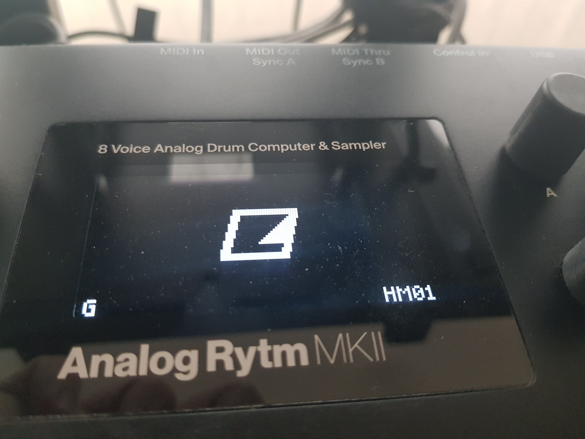
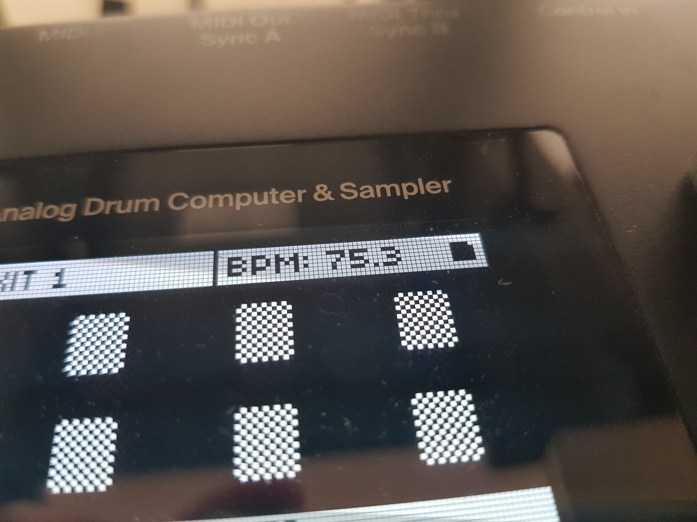
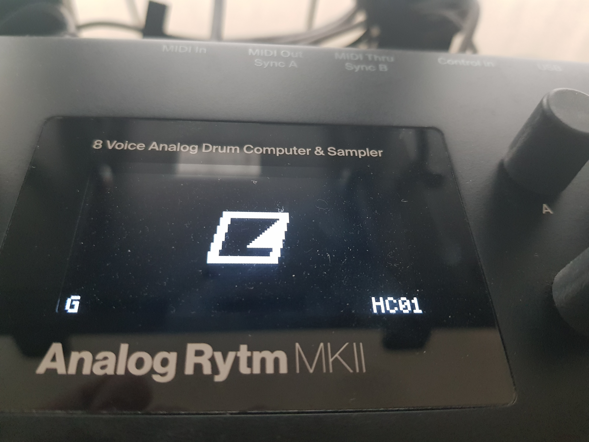
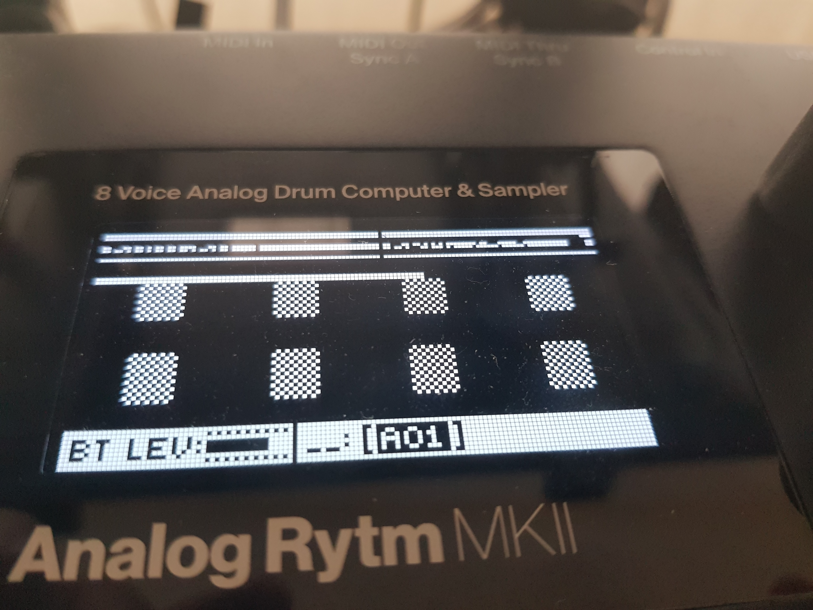
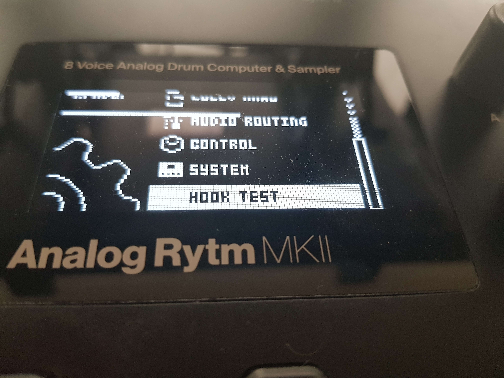

# Core report: an elemod core on the Analog Rytm MKII (OS 1.73)

This records the hardware runs behind Modwerk step 4, "Core with hooks", for the Analog Rytm MKII. The core is [elekloader](https://github.com/irpina/elekloader)'s Digitakt mk1 core (`core.s`, `settings.s`, `render.s`) built with the Rytm's addresses as `mods/core-ar2`, in [ConnorWay32/elekloader](https://github.com/ConnorWay32/elekloader) (`main`, 33c4837). Only hashes, addresses and photos are here: no firmware, dumps or extracted code.

## 1. What was built

| | |
|---|---|
| Stock OS | `Analog-Rytm_MKII_OS1.73.syx`, SHA-256 `8ad671087ec30433d5407c7380d2396e0915ab931c5d3dd18a78bf284d3d1e52` |
| Builder | elekloader (`python3 -m elekloader.sdk.build`, then `python3 -m elekloader.patch`), WSL Ubuntu, m68k-linux-gnu binutils and GCC |
| core 0.1 | `mods/core-ar2` → `core-0.1.elemod`, SHA-256 `b5b7b10f51ce4dae36384c193852db38080206c0417646a5752ff22ec737a5c1` (88 B `.boot`, 460 B `.run`) |
| hello-marker 1.0 | `examples/hello-marker-ar2` → SHA-256 `e13b677878b2227b8092c1256f37c4efc635c51d9bf83f1e232b72083f4f8e32` |
| hooks-check 0.1 | `examples/hooks-check-ar2` → SHA-256 `b2b9f1c11f637787590181d603f1e3bd1291c1d0a34deb76e1b07ac95debfab3` |

Two firmware files were built from these, each verified by the patcher (only MAIN OS changed, sections 1, 2, 5 and 8 byte for byte; the main OS depacks to the patched image in place):

| Build | Mods | Version field | `.syx` SHA-256 |
|---|---|---|---|
| HM01 | core 0.1 + hello-marker 1.0 | `HM01` | `340bf38ba920d56d3a90ff432478d193deacce433babf30451c32ca440f1197a` |
| HC01 | core 0.1 + hooks-check 0.1 | `HC01` | `32c5c574292631da43fd1042470015db584f8b36295f69dc0201bae767961d03` |

HC01 links core and hooks-check at `0x47BE0000`-`0x47BE0410` in the 128 KB mods' area; its container ends at flash `0x20A8D0`, below the `0x300000` limit. elekloader's TypeScript engine builds the same HC01 file byte for byte (`js/tools/parity.ts`).

## 2. The core's sites

Each is the counterpart of a site the Digitakt mk1 core hooks (OS 1.54); `mods/core-ar2/README.md` has the evidence.

| Event | Rytm 1.73 | Digitakt 1.54 |
|---|---|---|
| boot | `0x400008C0` | `0x40000538` |
| `ev_tick` | `0x400A2BEE` | `0x4000A770` |
| `ev_draw` | `0x400A2C56` | `0x4000A7D6` |
| `ev_key` | `0x400A47CC` | `0x4000B770` |
| `ev_enc` | `0x400A4816` | `0x4000B7BA` |
| `ev_settings` | `0x400DB87E` | `0x40058800` |
| `ev_render_in` | `0x4011FB02` | `0x40077428` |
| `ev_render_out` | `0x40121656` | `0x400784C8` |

## 3. On the unit

Tested on 11 October 2026; the photos below were taken on 12 October 2026. Both builds were sent with Elektron Transfer over USB, as in the boot report.

**HM01 (core + hello-marker).** The unit booted the build and reported version HM01. A 3x3 white square showed in the top-right corner of every screen. This shows the boot copier (the linked image copied to `0x47BE0000` at boot), the linker's placement and `ev_draw`.

| Boot screen | Marker |
|---|---|
|  |  |

**HC01 (core + hooks-check).** The unit booted and reported HC01. hooks-check subscribes to every event, takes none, and draws its counts as bars:

| Event | Expected | Seen |
|---|---|---|
| `ev_tick` | the corner square blinks about once a second | yes |
| `ev_render_in` | a bar crawls across in about 5.5 s and wraps | yes |
| `ev_render_out` | a second square appears only if the two render events ever disagree | never appeared |
| `ev_key` | a bar grows with each key press, repeat and release | yes |
| `ev_enc` | a bar grows with each encoder detent | yes |
| `ev_settings` | a HOOK TEST row after SYSTEM; selecting it grows a bar | yes; the other rows as stock |

The unit acted on every key and encoder as stock does. The same held through a short session with a pattern playing into the delay and reverb, a kit or sample loaded and patterns changed.

| Boot screen | Bars | SETTINGS |
|---|---|---|
|  |  |  |

## 4. Earlier test images

Before the core existed, two test images from [rytm-mods-src](https://github.com/ConnorWay32/rytm-mods-src)'s `elemod` branch checked the same ground:

- **The mods' area** (mod 0016): `0x47BE0000`-`0x47C00000` filled with an address-dependent pattern from the boot site at power-on; no word changed through playback, sampling, effects, MIDI, Overbridge and a power cycle.
- **The render sites** (mod 0017): a flag armed from `0x4011FB02` and the effect returns cleared from `0x40121656` on alternate 0.7 s stretches. The delay and the reverb pulsed, each on its own setting, with the reverb return PRE or POST.

## 5. Recovery

After each run, stock OS 1.73 (`Analog-Rytm_MKII_OS1.73.syx`, SHA-256 above) was sent the same way, with Elektron Transfer over USB, and the unit returned to stock. Neither build touches the bootstrap (section 2), so the STARTUP menu's recovery path (FUNC at power-on, TRIG 4, stock .syx over MIDI DIN) stays available as well.
